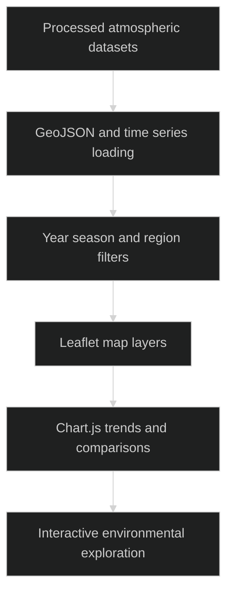

# HCHO India Observatory

> `Geospatial exploration of atmospheric formaldehyde, fire hotspots and trajectory datasets.`

### 🏗️ System Architecture



### 🛠️ Production Stack

JavaScript · Leaflet · Chart.js · GeoJSON · static JSON datasets · Docker

### ⚡ Key Engineering Capabilities

- Year and season controls coordinate geographic layers and charts.
- Fire hotspot and trajectory data provide additional spatial context.
- Static dataset delivery supports a small deployment without an application database.

### 🚀 Deployment and Local Setup

Run from the repository root after cloning:

```bash
git clone https://github.com/ryash14/HCHO.io.git
cd HCHO.io
docker build -t hcho-observatory .
docker run --rm -p 7860:7860 hcho-observatory
```

Open http://localhost:7860. Alternatively run `python3 -m http.server 7860`. Map tiles and browser libraries may require internet access. This repository serves processed datasets; it does not establish a reproducible upstream satellite-processing pipeline or causal attribution.

### Source Map

- [js/app.js](js/app.js)
- [processed_data/metadata.json](processed_data/metadata.json)
- [Dockerfile](Dockerfile)
