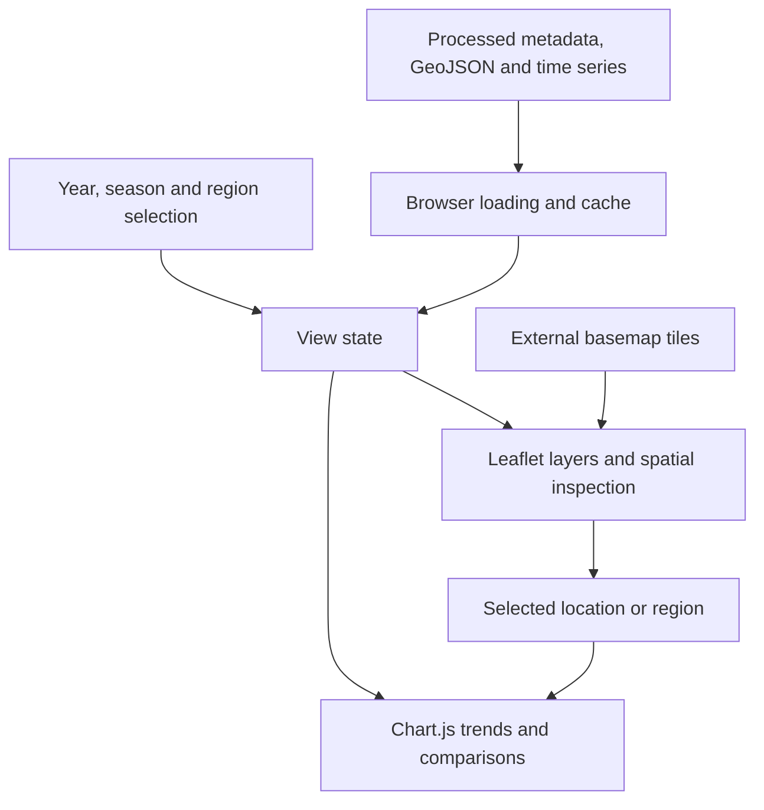

# HCHO India Observatory

HCHO India Observatory explores processed atmospheric formaldehyde data alongside fire hotspots and transport trajectories.

A national atmospheric dataset is difficult to inspect as a collection of isolated files. The observatory places time-series and geographic views in one interface, allowing a reader to move between seasonal patterns, regional comparisons and supporting spatial layers.

[Quick start](#quick-start) · [How it works](#how-it-works) · [Development](#development) · [Contributing](CONTRIBUTING.md)

## Quick start

Use Docker, or Python for static hosting. Basemap tiles and externally loaded browser libraries may need an internet connection. Keep the processed data directory with the site assets.

From a fresh checkout:

```bash
git clone https://github.com/ryash14/HCHO.io.git
cd HCHO.io
docker build -t hcho-observatory .
docker run --rm -p 7860:7860 hcho-observatory
```

Open http://localhost:7860. Alternatively run `python3 -m http.server 7860`. Map tiles and browser libraries may require internet access. This repository serves processed datasets; it does not establish a reproducible upstream satellite-processing pipeline or causal attribution.

## Reading the data views

The year and season controls select among processed assets, while map interaction supplies the current geographic context. Use the chart panel to inspect the time-series view for a selected location instead of interpreting a single map color as a trend. The dataset boundaries and available fields are described in `processed_data/metadata.json`.

Layers can combine observations and derived products with different assumptions. Consult the underlying metadata before comparing them; the site is an exploration interface rather than a replacement for the upstream scientific methods.

## How it works

1. Select a year, season and region.
2. Inspect the formaldehyde layer together with hotspot, fire or trajectory overlays.
3. Open the chart panel to compare trends and nearby locations.
4. Read the processed metadata to understand the available dataset coverage.

### Component boundaries



### Design decisions

The application loads precomputed JSON, GeoJSON and raster assets in the browser. Leaflet manages spatial layers and map interaction; Chart.js renders trend and comparison views. Client caches reduce repeated asset loading.

The checked-in Docker image serves static files. It does not run an upstream satellite-processing or atmospheric transport pipeline. Geographic overlap is exploratory context, not proof of causal attribution.

## Implementation

**Stack:** JavaScript · Leaflet · Chart.js · GeoJSON · static JSON datasets · Docker.

- [js/app.js](js/app.js)
- [processed_data/metadata.json](processed_data/metadata.json)
- [Dockerfile](Dockerfile)

## Development

There is no complete automated verification command documented for this application. Start the affected component, use a small synthetic input and inspect its output before changing integrations. The contribution guide describes the evidence expected in a pull request.

## Contributing and support

Report reproducible bugs or propose changes through [GitHub Issues](https://github.com/ryash14/HCHO.io/issues). Include the relevant environment and a small example rather than private datasets or credentials. See [contributing](CONTRIBUTING.md), [security reporting](SECURITY.md) and the [code of conduct](CODE_OF_CONDUCT.md).

## License

No repository-wide license is currently provided. Third-party components, models and datasets retain their own terms.
